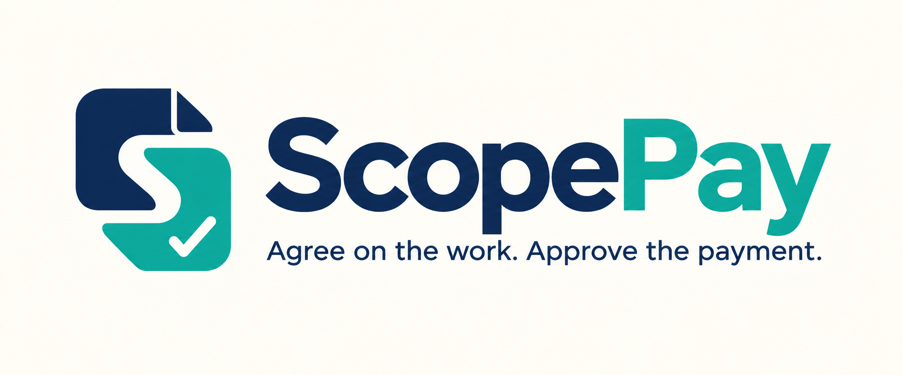
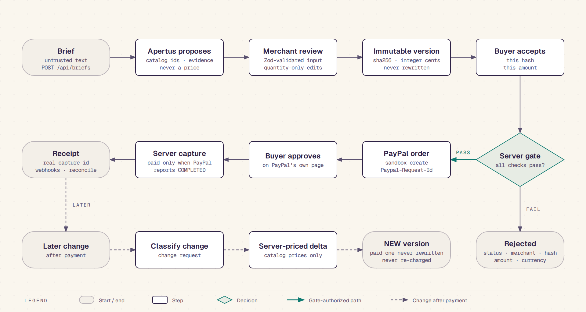
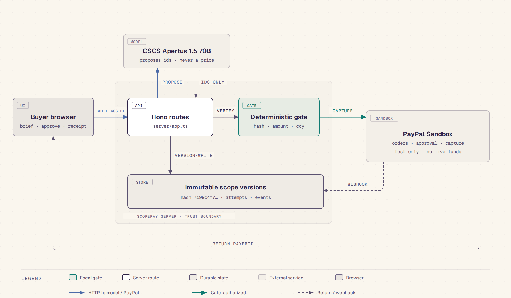

<p align="center"></p>

# ScopePay

ScopePay turns a freelancer's messy client brief into a reviewed, priced scope, and ties one exact version of that scope to a PayPal sandbox payment.

- **Live demo:** https://scopepay.young-disk-9d1c.workers.dev ([how to test](docs/TESTING.md))
- **Demo video:** https://youtu.be/qU9lIEazpBw (source: [`videos/videos/m2_sandbox_demo/demo.mp4`](videos/videos/m2_sandbox_demo/demo.mp4))
- **Sandbox only.** No real money moves, and the PayPal client refuses any live environment.

## How it works



1. You paste a brief. Apertus 1.5 70B proposes catalog items, with evidence from the brief. It proposes no prices.
2. The server prices each line from its own catalog, in integer cents.
3. The merchant reviews the scope. Approval seals an immutable version with a sha256 hash.
4. The buyer accepts that hash and amount. A server gate checks status, merchant, hash, amount and currency before it calls PayPal.
5. The buyer approves on PayPal's page. The server captures, and records the payment only when PayPal reports `COMPLETED`.
6. A later change gets classified by the model and priced by the server, and becomes a new version. A paid version stays as it was.

Diagram sources: [`docs/payment-flow.svg`](docs/payment-flow.svg), [`docs/payment-flow.html`](docs/payment-flow.html).

## Architecture



The browser holds only publishable configuration. The server owns the catalog, the pricing, the gate and the credentials. Apertus sits behind an id-only contract. PayPal decides whether money moved.

Stack: a Vite + React client, Hono server routes, Zod at every untrusted input, and one storage interface with three adapters (memory, local file, Cloudflare D1). The demo runs on Cloudflare Workers with D1.

Built with [diagram-design](https://github.com/cathrynlavery/diagram-design) at `11b08ea`. Sources: [`docs/architecture.svg`](docs/architecture.svg), [`docs/architecture.html`](docs/architecture.html). Export with `node videos/scripts/export-diagram.mjs`, and check with `node videos/scripts/check-diagram.mjs`.

## Proof

| Step | Route | Status |
| --- | --- | --- |
| Brief extraction | `POST /api/briefs` | Live on CSCS Apertus 1.5 70B |
| Merchant review | `POST /api/scopes/:id/review` | Quantity edits only |
| Buyer acceptance | `POST /api/scopes/:id/accept` | Checks hash, amount, currency |
| Sandbox order | `POST /api/scopes/:id/orders` | Live on PayPal sandbox |
| Capture | `POST /api/scopes/:id/capture` | Live; refuses any order that is not `APPROVED` |
| Reconciliation | `POST /api/scopes/:id/reconcile` | Live on PayPal sandbox |
| Webhook | `POST /api/webhooks/paypal` | Registered on the demo; real signed events verified, forged ones rejected |
| Change request | `POST /api/scopes/:id/changes` | Live on Apertus, server-priced |

Real sandbox captures, each reconciled as `COMPLETED`:

| Where | Order | Capture | Amount |
| --- | --- | --- | --- |
| Local server | `0SL05738S7262304T` | `6YS286962F723210Y` | 1640.00 USD |
| Hosted demo | `59X35490DC4776137` | `6FT34085B6964715H` | 1460.00 USD |
| Hosted demo | `05T53487Y0618223Y` | `2E2674460M099332D` | 1460.00 USD |
| Hosted demo, manual approval | `85556611218642647` | `70J91999JH7336835` | 1460.00 USD |

Lightpanda drove the hosted app and Moli approved on PayPal. Commands, results and the defects they found: [`docs/proof/PROOF_M2_SANDBOX.md`](docs/proof/PROOF_M2_SANDBOX.md) and [`docs/proof/SMOKE_TEST_M0.md`](docs/proof/SMOKE_TEST_M0.md).

## Run it locally

```bash
npm install
cp .env.example .env       # set CSCS_INFERENCE_API_KEY; add PayPal sandbox keys to test payments
npm run check              # typecheck and tests
npm run dev                # API on :8790, client on :5173
```

Set `PUBLIC_BASE_URL` to the origin that serves the client, because PayPal returns the buyer there. Locally it defaults to `http://localhost:5173`. Without PayPal sandbox keys, the payment routes answer `503 paypal_not_configured` and the app disables checkout.

Deploy to Cloudflare: see [`docs/DEPLOYMENT.md`](docs/DEPLOYMENT.md) and `wrangler.toml`.

## Docs

[API contract](docs/API_CONTRACT.md) · [Deployment](docs/DEPLOYMENT.md) · [Testing](docs/TESTING.md) · [Evaluation](docs/EVALUATION.md) · [Progress](docs/PROGRESS.md) · [Built with](docs/BUILT_WITH.md) · [License](LICENSE)

## Limits

- One merchant, one USD catalog. No tax, shipping, refunds, payouts or marketplace.
- Not proven yet: a webhook that changes payment state before the app does, redelivery of a real event, timeouts and declines. Real events so far arrived after the app's own capture.
- Extraction quality over the 20 frozen briefs is not measured yet.
- The build uses Vite + React + Hono instead of the Sites Vinext starter that `PROJECT_BUILD.md` names, because the Sites tooling is not installed here. `docs/DEPLOYMENT.md` records this.
